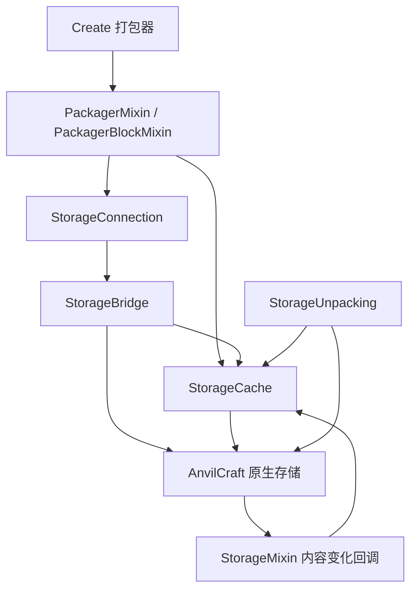

# 架构与改进建议

## 当前结构

项目是单 Gradle 模块，包含 9 个 Java 源文件。它通过 Create 的扩展注册点、物品接口和
三个 Mixin 将 AnvilCraft 的原生存储接入打包与仓储系统，没有注册新方块或自定义网络协议。

| 文件 | 职责与边界 |
| --- | --- |
| `PackageConnect` | 注册库存身份与拆包处理器、缓存生命周期、统计命令和开发自检入口。 |
| `StorageConnection` | 解析四种支持的存储及其多方块主部件，管理物品接口绑定，以 UUID 判断库存身份。 |
| `StorageBridge` | 将 AnvilCraft handler 适配为 `IItemHandler`；为普通打包与订单打包提供索引视图。 |
| `StorageCache` | 按 UUID 共享缓存，维护槽位与物品组件索引、聚合数量、空间占用及 Create 库存摘要。 |
| `StorageUnpacking` | 先模拟整包容量，再通过原生 handler 插入；支持类型限制、空间限制和溢出销毁。 |
| `PackagerMixin` | 替换库存连接行为，接入共享摘要、订单提取与同库存识别。 |
| `PackagerBlockMixin` | 对支持的存储补充放置朝向，保留 Create 的容器方向优先级。 |
| `StorageMixin` | 在 AnvilCraft 内容变化后通知共享缓存。 |
| `IntegrationChecks` | 专用开发服务器中的存储和世界集成断言。当前仍位于主源码集中。 |

## 主要数据流程

1. 初始化时为四种存储注册 Create 的 `InventoryIdentifier` 和 `UnpackingHandler`。
2. 打包器查找相邻存储：解析多方块主部件，取得 UUID 对应的 SavedData 存储，建立适配接口。
   普通容器继续走 Create 原有路径；客户端放置预览只进行方块解析。
3. 首次读取库存时建立缓存。缓存键包含物品及数据组件，数量使用 `long`；向 Create 暴露摘要时
   按其 `BigItemStack.INF` 饱和。UUID 全服共享，库存身份比较不包含维度。
4. 原生存储发生变化后，Mixin 回调只刷新受影响槽位；无效或批量索引标记整个缓存待重建。
   handler 实例变化时替换缓存，最多保留 256 个存储，服务器停止时清理。
5. 普通打包遍历物品类型；订单打包读取当前请求，通过索引定位匹配槽位。原生提取触发的回调
   同步更新缓存，因此提取前需要复制匹配槽位集合。
6. 拆包在服务器线程先检查整包累计容量；通过后调用原生插入。此流程依赖单线程及预判与上游
   handler 语义一致，并没有通用回滚事务，修改时必须特别验证这些前提。

## 本次选择

保留现有单模块及职责划分。对当前规模再增加服务接口层、依赖注入框架或拆分多个 Gradle
模块，收益不足以抵消维护成本。

编码约束分为两层：`AGENTS.md` 记录语义边界和工作流程；构建使用固定版本的 Spotless /
`google-java-format` 与 Checkstyle 内置完整 Google 规则检查 Java。`styleCheck` 对源文件工作，
不需要游戏编译依赖；`check` 和 `build` 同样执行风格检查。项目自有说明性注释使用中英文双语。
GitHub Actions 独立执行 `styleCheck`，并配置 Linux、Windows、macOS 构建。
风格工具不验证库存正确性、Mixin 注入成功或运行时兼容性。

构建依赖改为 Gradle 自动下载，移除 Windows 专用脚本和本地 `libs` 要求。Create 6.0.10 与
AnvilCraft `1.6.0+snapshot.2465` 分别使用固定 Modrinth 发布 ID `UjX6dr61`、`85SOrOGM`。
版本集中记录在 `gradle.properties`，仓库按依赖组限制范围，避免本地 Maven 内容影响构建。

运行时使用完整发布 JAR，由 NeoForge 发现它们原有的 jar-in-jar 依赖；编译时通过
`compileOnly` 引入匹配的 Ponder `1.0.82+mc1.21.1` 和 AnvilLib `2.0.0+snapshot.546`，
让 javac 能访问嵌套库中的类型。第三方库不再由本附属解压或打包，也不额外添加运行时副本。

仓库使用 ModDev 的项目级依赖仓库。该插件本身会注册项目仓库，Gradle 默认会因此忽略
`settings.gradle` 中的依赖仓库；依赖来源应在 `build.gradle` 的同一层声明。
新增 `runClient` 提供跨平台开发入口，`runServer` 保留原有功能自检用途。

## 建议的后续改进

### 优先处理：隔离开发自检并可靠报告失败

`IntegrationChecks` 目前和正式实现一起打包；`PackageConnect` 在系统属性打开时调度它。
自检会修改世界并关闭服务器。其 `run` 方法捕获 `Throwable` 后只写失败日志，然后关闭服务器，
因此 `runServer` 的成功退出不能证明断言通过。

建议单独建立开发用 source set / 测试模组，将启动监听也移入该入口；再提供独立验证任务，
通过测试框架报告或明确的结果文件使断言失败成为任务失败。生产 JAR 应不包含自检入口。
这需要核对 NeoForge 开发运行配置，不能只移动一个 Java 文件。

验收时既检查成功路径，也故意使一个断言失败，确认任务返回失败；检查正式 JAR 不含自检类，
并在专用测试世界重新覆盖现有场景。此项属于行为和构建架构调整，本轮作为建议保留。

### 随需求演进：收紧缓存内部状态的访问

`StorageUnpacking` 直接读取缓存的 handler 和空间占用，自检直接读取索引和统计计数。
这些包内访问让当前实现很紧凑，但也使容量算法与索引表示耦合。

若继续扩展存储类型，建议先提供只读的容量信息、查询接口和统计快照，再按需要拆出容量策略。
迁移时需验证重复物理槽位的类型计数、数据组件隔离、累计空间权重和溢出销毁行为。
当前没有必要仅为分层而增加一套通用存储框架。

## 验证边界

`styleCheck` 只证明自动风格规则通过；`build` 自动解析固定依赖并编译、打包。
`prepareClientRun` 与 `prepareServerRun` 可以验证运行文件和依赖准备，但不会启动游戏，
因此也不能证明 Mixin 注入和运行时行为正确。
现有功能自检只能在专用开发世界运行，并应以当次日志的 PASS / FAIL 为准。
README 记载的 111 项断言是历史结果，不代表任意后续修改都已通过游戏验证。
