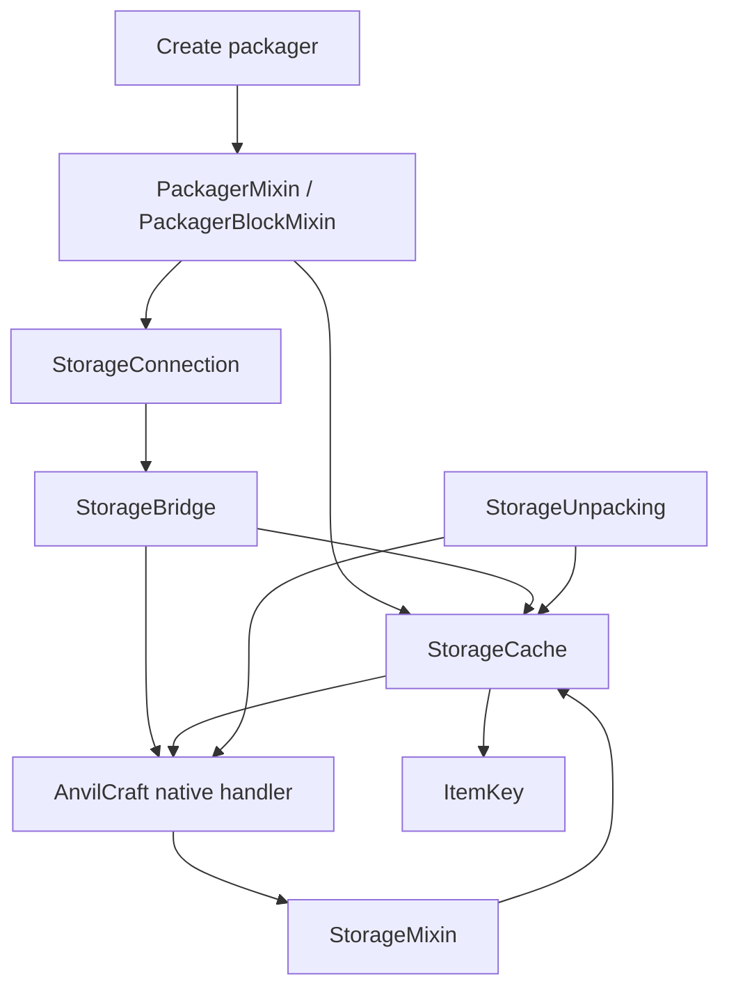

# 架构 / Architecture

## 职责与源码集 / Responsibilities and source sets

项目保留单 Gradle 模块，通过 Create 注册点、物品接口和三个 Mixin 接入 AnvilCraft。
没有增加新方块、网络协议、依赖注入框架或第二份库存。

The project remains a single Gradle module, integrating through Create registries, item handlers,
and three Mixins. It adds no blocks, network protocol, dependency injection framework, or inventory copy.

| 位置 / Location | 职责 / Responsibility |
| --- | --- |
| `src/main/.../PackageConnect` | 注册、统计命令与服务器停止清理。 Registration, statistics command, and server-stop cleanup. |
| `StorageConnection` | 已加载方块及多方块解析、服务端存储访问、连接重绑定和全服身份。 Loaded block/multipart resolution, server storage access, rebinding, and global identity. |
| `StorageBridge` | 原生物品接口适配；普通打包类型快照与实时订单队首视图。 Native item adaptation, a type snapshot for ordinary packing, and a live order-head view. |
| `ItemKey` | 私有物品及组件快照、稳定哈希和原生空间权重。 Private item/component snapshot, stable hash, and native space weight. |
| `StorageCache` | 按 UUID 共享的物理槽位索引、类型聚合、库存摘要和不可变统计快照。 UUID-shared physical slot index, aggregate counts, stock summaries, and immutable statistics. |
| `StorageUnpacking` | 整包容量预判与原生提交，按三类 handler 分离规则。 Whole-package planning and native commit, with rules separated by handler family. |
| `mixin` | 内容回调、库存连接、摘要、提取、同库存判断及放置方向的上游注入。 Upstream hooks for mutations, connections, summaries, extraction, identity, and placement. |
| `src/test/` | 不启动世界的真实 handler 回归与差分测试。 Real-handler regression and differential tests without a world. |
| `src/integrationTest/` | 专用开发世界检查、启动监听及结果写入。 Dedicated development-world checks, startup listener, and result writer. |

## 连接与身份 / Connections and identity

`resolveBlock` 只读取已加载方块，可供客户端放置预测使用；多方块先解析主部件，再检查主部件
区块是否已加载。`storage` 要求处于服务器线程，才允许分配 UUID、更新销毁设置和访问 SavedData。
库存身份只比较全服 UUID，维度仅用于查询方块面。连接在访问时重新确认存储实例；替换为普通容器
时立即委托 Create 查询，保留其过滤器、朝向和未加载区块保护。

`resolveBlock` reads only loaded blocks and is safe for client placement prediction. Multipart lookup
also checks that the main part is loaded. `storage` requires the server thread before assigning UUIDs,
refreshing disposal settings, or accessing SavedData. Inventory identity compares server-wide UUIDs;
the level only resolves queried faces. Access revalidates the storage instance. Replacement by an ordinary
container immediately delegates to Create, preserving filters, orientation, and unloaded-chunk guards.

## 索引与提取 / Indexing and extraction

缓存注册表是访问顺序的有界映射，最多保留 256 个存储；同 UUID 的 handler 变化时替换缓存，
服务器停止时释放所有引用和统计。索引字段不向容量算法、适配器或测试暴露可变集合。

The access-ordered registry retains at most 256 storages. A handler change replaces that UUID's cache;
server shutdown releases references and resets statistics. Mutable index collections are private.

物理槽位使用 fastutil 的 `Int2ObjectOpenHashMap`，每种物品的槽位集合使用 `IntAVLTreeSet`。
这些库由 Minecraft 提供，不额外下载或嵌入运行时副本。同类型数量变化只更新差值，复用键及槽位
集合，并保持普通打包的类型顺序。类型改变或槽位清空才修改集合；批量回调标记下一次读取时重建。

Physical slots use fastutil's `Int2ObjectOpenHashMap`; each item type uses an `IntAVLTreeSet` of slots.
Minecraft already supplies these libraries. Count-only changes update deltas while reusing keys and slot
sets, preserving type order for ordinary packing. Type changes and emptied slots update the collections;
bulk callbacks defer rebuilding until the next read.

原生提取会同步修改索引，因此不能边遍历原集合边提取。单槽足够时直接提取；跨槽时只复制满足
本次数量所需的槽位，不再复制全部匹配槽位。模拟直接返回独立物品副本，不调用真实提取。

Native extraction synchronously mutates the index, so extraction cannot iterate the live set. A sufficient
single slot is used directly; multi-slot extraction snapshots only enough slots for this request instead
of every matching slot. Simulation returns a separate stack without performing native extraction.

聚合数量使用 `long`，Create 摘要中的每种数量封顶为 `BigItemStack.INF`。`ItemKey` 不暴露持有的
可变物品；类型列表和摘要获得物品副本。摘要本身仍是 Create 的可变对象，调用方必须按共享只读
约定使用；`submitNewArrivals` 会扣减旧摘要，Mixin 在调用前复制旧摘要。切回普通容器时也先
分离旧共享摘要，避免 Create 原生分支继续修改其他打包器正在使用的数据。

Aggregates use `long`; per-type Create counts saturate at `BigItemStack.INF`. `ItemKey` never exposes
its mutable stack: type lists and summaries receive copies. The shared summary remains a mutable Create
object and must be treated as read-only. The Mixin copies the old summary before `submitNewArrivals`,
which subtracts from that argument. Switching back to an ordinary container also detaches the old shared
summary before Create's native branch can mutate data still used by other packagers.

## 拆包契约 / Unpacking contract

`StorageUnpacking` 只通过数量、占用槽位和空间查询使用缓存，独立读取原生容量设置。
预判严格保留包内顺序：

`StorageUnpacking` queries only counts, occupied slots, and used space from the cache, and reads native
capacity settings separately. Planning preserves package order:

- 无限存储只检查物品有效性，无需为了容量建立库存索引。
  Infinite storage checks item validity without building an index just to plan capacity.
- 类型受限存储累计每种组件键的新增量；类型数使用占用的物理条目数，包括迁移的重复条目。
  Type-limited storage accumulates additions per component key and counts occupied physical entries,
  including migrated duplicates, against the type limit.
- 空间受限存储调用上游 `computeSpace(stack, 1)`，累计真正保留的数量。销毁模式可丢弃普通
  溢出物品，永恒物品仍必须完整容纳。
  Space-limited storage uses upstream `computeSpace(stack, 1)` and charges only retained items.
  Disposal may discard ordinary overflow; eternal items must still fit completely.

全包通过预判后才通过原生 handler 提交，每次传入物品副本。流程依赖服务器单线程与固定上游
语义，不提供通用回滚。如果上游返回非空余量，立即抛出错误，不能把部分插入当作成功。

Commit uses the native handler with stack copies only after the entire package fits. This relies on the
server thread and the pinned upstream semantics, not general rollback. A nonempty remainder throws an
error rather than treating a partial insertion as success.

## 构建与验证 / Build and validation

依赖集中固定在 `gradle.properties`。Create、AnvilCraft 使用完整 Modrinth 发布 JAR；NeoForge
发现其 jar-in-jar 库，编译时通过匹配版本的 Ponder、AnvilLib `compileOnly` 声明暴露嵌套类型。
仓库按依赖组限制范围，不依赖本地 `libs`、`mavenLocal()` 或提取脚本。JUnit 仅用于测试。

Dependencies are pinned in `gradle.properties`. Complete Modrinth releases provide Create and AnvilCraft;
NeoForge discovers their jar-in-jar libraries. Matching compile-only Ponder and AnvilLib dependencies
expose nested types to javac. Repositories are group-scoped, with no local `libs`, `mavenLocal()`, or
extraction script. JUnit is test-only.

三个源码集保持同一模块。ModDev 的正式模组模型只包含 `main`，服务器检查模型合并 `main` 与
`integrationTest`；每个运行配置显式选择一个模型，避免重复加载或跨模组拆分相同 Java 包。
客户端和正式 JAR 不包含开发检查入口。`PackageConnect` 不知道自检类或自检开关。

Three source sets remain in one module. ModDev's release model contains only `main`; the server-check
model combines `main` and `integrationTest`. Each run explicitly selects one model to avoid duplicate
loading or splitting a Java package across mods. The client and release JAR exclude the development
entrypoint. `PackageConnect` has no reference to check classes or switches.

| 命令 / Command | 保证与边界 / Evidence and limits |
| --- | --- |
| `spotlessApply` | 显式格式化；检查任务不会执行它。 Explicit formatting; verification never invokes it. |
| `styleCheck` | 三个源码集的 Spotless 和完整 Google Checkstyle；无需编译游戏。 Spotless and complete Google Checkstyle across all source sets, without game compilation. |
| `test` | 真实 handler 的 JUnit 回归，包括 360 组固定种子差分场景；测试回调替代 SavedData 通知，不代表 Mixin 验证。 Real-handler JUnit regression with 360 fixed-seed differential scenarios; fixture callbacks replace SavedData notification and do not prove Mixin behavior. |
| `build` | 风格、JUnit、正式打包及世界检查编译，不启动服务器。 Style, JUnit, release packaging, and world-check compilation; no server launch. |
| `prepareClientRun` / `prepareServerRun` | 运行文件准备，不代表游戏检查通过。 Run-file preparation, not game validation. |
| `runServer` | 专用世界真实集成检查；要求当次成功报告，随后关闭服务器。 Real integration checks in a dedicated world; requires a fresh success report and shuts down. |

`runServer` 启动前删除旧的 `build/reports/integrationTest/result.txt`。开发入口写入 `PASS <断言数>`
或 `FAIL`，Gradle 验证结果；缺失报告也失败。`-PselfTestFailure=true` 在首个断言触发故意失败，
用于验证失败传播，正常验证时不传此属性。报告与世界文件均不提交。

Before launch, `runServer` removes the old `build/reports/integrationTest/result.txt`. The development
entrypoint writes `PASS <assertion count>` or `FAIL`; Gradle checks it and also fails on a missing report.
`-PselfTestFailure=true` deliberately fails the first assertion to verify failure propagation. Omit that
property for normal verification. Reports and worlds are not committed.

专用自检会改动世界并关闭服务器，不能连接实际服务器或复用游玩存档。固定版本的上游开发
启动器在开发模式跳过 EULA 文件检查；项目不写入接受协议的文件，也不向生产启动器增加绕过
选项。客户端渲染、仅服务端安装的联机组合和真实耗时基准需要单独验证，不能由计数器推断。

World checks mutate the world and stop the server; never use a real server or gameplay save. The pinned
upstream development launcher skips the EULA file check in development mode. This project neither writes
acceptance files nor adds bypass options for production launchers. Client rendering, server-only addon
installation in multiplayer, and elapsed-time performance benchmarks need separate validation.
